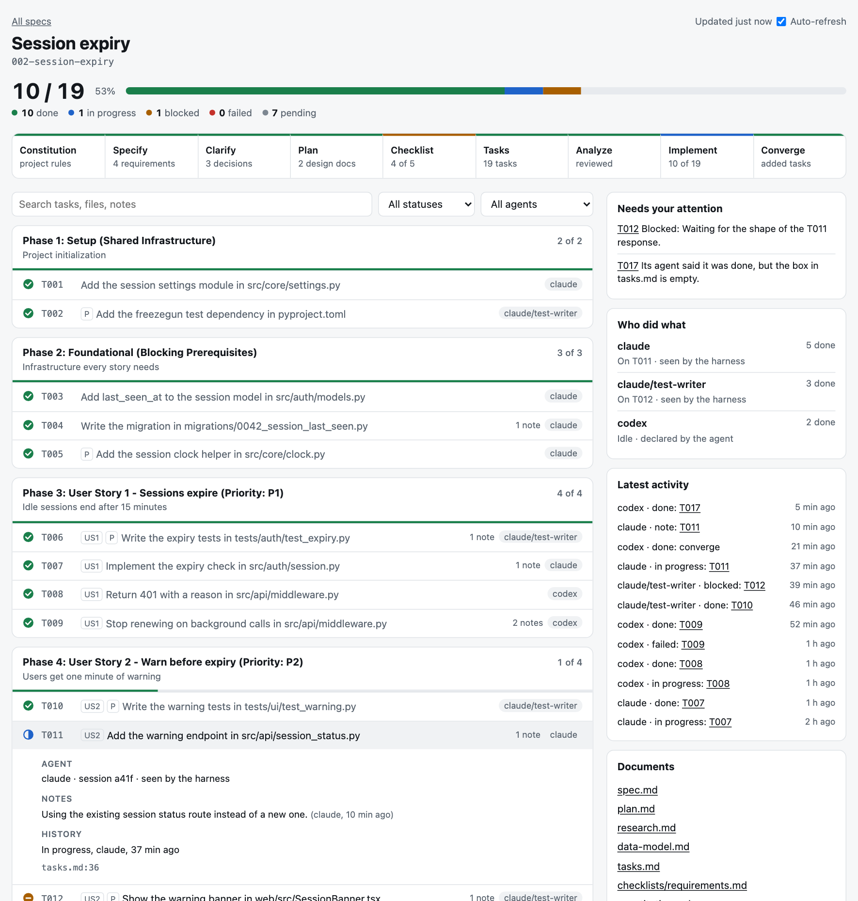

<div align="center">
    
    <h1>Spec Kit</h1>
    <h3><em>Build with a spec, fix a bug, or assess an idea — with your coding agent.</em></h3>
</div>

> [!NOTE]
> This repository is a fork of [github/spec-kit](https://github.com/github/spec-kit). See [What this fork changes](#what-this-fork-changes). Install it from this repository, as shown in [Install](#install), not from PyPI: the `specify-cli` package on PyPI is the original project and does not include these changes.

<p align="center">
    <a href="https://github.com/lema017/speckit-vs/releases/latest"></a>
    <a href="https://github.com/lema017/speckit-vs/stargazers"></a>
    <a href="https://github.com/lema017/speckit-vs/blob/main/LICENSE"></a>
    <a href="./docs/index.md"></a>
</p>

<p align="center">
    <strong>English</strong> ·
    <a href="./README.zh-CN.md">简体中文</a> ·
    <a href="./README.ja.md">日本語</a> ·
    <a href="./README.ko.md">한국어</a>
</p>

Spec Kit is an open source toolkit that gives AI coding agents structured
processes, reusable templates, and documented outcomes. Start with a ready-made
process, customize it, or bring your own.

<a id="-get-started"></a>
<a id="-prerequisites"></a>
<a id="get-started"></a>

## Install

You need [uv](https://docs.astral.sh/uv/getting-started/installation/), Git, and a
[supported coding agent](docs/integrations/index.md), on Linux, macOS, or Windows.
uv downloads Python 3.11 or later if your machine does not have it.

<!-- Keep the tag in this section on the latest release. -->

Install the latest release, `v1.5.3`:

```bash
uv tool install specify-cli --from git+https://github.com/lema017/speckit-vs.git@v1.5.3
```

- **It takes a few minutes the first time.** It installs about 165 MB, most of it
  [Graphify](#graphify-a-code-graph-for-the-catalog), which comes with this fork.
- **If `specify` is already installed**, from PyPI or an older release of this fork,
  add `--force` to replace it.
- **If your shell cannot find `specify`** afterwards, run `uv tool update-shell` and
  open a new terminal.

Check that you installed this fork and not the original:

```bash
uv tool list --show-version-specifiers
```

Its `specify-cli` line should show `v1.5.3` and this repository's URL with the tag,
`git+https://github.com/lema017/speckit-vs.git@v1.5.3`.

Create a project with your agent's integration key, such as `claude`, `copilot`,
`cursor-agent`, `gemini`, or `codex`. `specify integration list` shows all 43:

```bash
specify init my-project --integration claude
```

To set up the folder you are in, even if it already has code, run
`specify init --here --integration claude` instead. Then open your coding agent in
the project folder and [choose a process](#choose-your-process).

<a id="-supported-ai-coding-agent-integrations"></a>

For other setups, see these guides in this repository:

- [Installation](docs/installation.md) for pipx, pip, a one-time run with `uvx`, CI, and troubleshooting.
- [Air-gapped installation](docs/install/air-gapped.md) for machines without access to GitHub.
- [Existing projects](docs/how-to/existing-projects.md) to start with code you already have.
- [Integrations](docs/integrations/index.md) for every agent's key and [invocation syntax](docs/integrations/cli.md#command-invocation).

### Update a project you already have

This works for a project set up with an older release of this fork or with the
original Spec Kit. Install the new release:

```bash
uv tool install specify-cli --force --from git+https://github.com/lema017/speckit-vs.git@v1.5.3
```

Then, from the project's directory, with your integration key in the first command:

```bash
specify integration upgrade claude
```

```bash
specify extension add capabilities --force
```

Both keep your configuration. See [Upgrade](docs/upgrade.md) for the details.

### If you are an AI agent installing this repository

Someone gave you this repository's URL and asked you to install it. Follow these
steps in order:

1. **Check the tools.** Run `uv --version` and `git --version`. If uv is missing, ask
   the user before you install it. The official installers are
   `curl -LsSf https://astral.sh/uv/install.sh | sh` on macOS and Linux, and
   `powershell -ExecutionPolicy ByPass -c "irm https://astral.sh/uv/install.ps1 | iex"`
   on Windows.
2. **Install from the Git URL with the tag.** Run the `uv tool install` command
   above, and allow it at least 10 minutes. Do not use `pip install specify-cli`,
   `uvx specify-cli`, or `uv tool install specify-cli` without `--from`: all three
   install the original Spec Kit from PyPI. You do not need to clone the repository.
3. **Replace an older install.** If uv says `specify-cli` is already installed, run
   `uv tool list --show-version-specifiers`. Unless it shows this repository's URL
   with the tag above, run the install again with `--force`.
4. **Verify.** `uv tool list --show-version-specifiers` shows this repository's URL
   with the tag, and `specify progress --help` prints its usage. The original Spec Kit
   has no `progress` command. `specify check` lists Graphify `0.9.102`. If the shell
   cannot find `specify`, run it by its full path in the folder that
   `uv tool dir --bin` prints. Ask the user before you run `uv tool update-shell`,
   because it edits their shell profile.
5. **Set up a project only if the user asked for one.** Use the folder and the agent
   the user named, and ask only for what they did not say. Run it without prompts:

   ```bash
   specify init my-project --integration claude --non-interactive
   ```

   - For the current folder, run
     `specify init --here --integration claude --non-interactive --force`. Without
     `--force` it stops when the folder is not empty. It adds Spec Kit's files and
     leaves the files already there as they were.
   - If it stops because the agent's command-line tool is missing, for example
     because you run inside an IDE or a desktop app, add `--ignore-agent-tools`.
   - On Windows, `init` uses PowerShell scripts, and then it leaves out the
     [capability catalog](#the-capability-catalog).
6. **Tell the user** the version you installed, the project folder and integration,
   and that Spec Kit's commands, such as `/speckit-specify`, run in the agent's chat,
   not in the terminal. Their exact syntax depends on the agent: see
   [Command invocation](docs/integrations/cli.md#command-invocation).

## What this fork changes

Spec Kit carries one change from a spec to working code. This fork keeps that
flow and adds what it leaves open: a record of what the software is supposed to
do today, across every feature built so far, a longer interview to clarify a spec,
and a check that can stop a pull request that disagrees with that record.

<picture>
  <source media="(prefers-reduced-motion: reduce)" srcset="media/fork-flow.png">
  
</picture>

| Problem in Spec Kit's core | How this fork solves it | Where |
| --- | --- | --- |
| Specs say what one change wanted, not what is true today. To find the current session timeout, you read every spec that touched it, in order | It keeps the rules in force in one catalog, by capability, and copies each approved change there by script | [The capability catalog](#the-capability-catalog) |
| A new spec can contradict or change a rule that nobody remembered, or change again after you reviewed it | It loads the affected rules before writing the spec, which then declares each change with a literal `From` and `To`. Before planning, it compares the spec with the sealed delta and you decide | `context`, `review` |
| Once a feature ships, nothing keeps track of a requirement and code that disagree | It records the requirement and what the code does separately, and neither overwrites the other | `fold` |
| A new agent session has to search for where a behaviour lives, which change set it, and which test covers it | Each rule records its origin, code, and tests. `locate` answers from the catalog first and warns when a reference no longer exists. A code graph answers what a change affects | [Graphify](#graphify-a-code-graph-for-the-catalog) |
| `/speckit.clarify` stops at five questions, even when decisions depend on each other | It interviews you in rounds until every open decision is settled. Before the first question, a hook gives it what the catalog and the code graph already know. It looks up other facts itself and asks you only for decisions, each with a recommended answer | [`/speckit.clarify-deep`](#clarify-until-the-decisions-are-settled) |
| A pull request can change a recorded rule or its tested code without a spec, or two branches can change the same rule | It compares the pull request with the catalog and your test report, and fails if they do not agree | [`check`](#catch-drift-at-the-pull-request) |
| Code written before Spec Kit has no recorded rules | It proposes a capability map from the code and waits for your approval. Rules stay `[inferred]` until you validate them | `/speckit.capabilities.bootstrap` |
| While agents work, you cannot see what the whole plan is, which tasks are done, or which agent did what | Each spec gets a page that stays current, with every task, the totals, who did what, and the notes on each task | [Progress page](#see-how-far-a-spec-has-come) |

`/speckit.clarify`, `/speckit.plan`, `/speckit.tasks`, `/speckit.converge`, and
`/speckit.analyze` do the same work, and only record that they ran and link to the
progress page. `/speckit.implement` also reports each task. `/speckit.specify` also
gains a handoff to `/speckit.clarify-deep`. `specify self check` and
`specify self upgrade` follow this repository instead of `github/spec-kit`.

### How Spec Kit's core turns a spec into code

Each feature gets its own folder under `specs/`, and each command works from what
the one before it wrote:

<picture>
  <source media="(prefers-reduced-motion: reduce)" srcset="media/core-flow.png">
  
</picture>

| Command | What it is told to read | What it writes |
| --- | --- | --- |
| `/speckit.specify` | Your request, the spec template, the constitution if there is one | `specs/NNN-name/spec.md` |
| `/speckit.clarify` | That spec, the constitution | Answers in the same spec |
| `/speckit.plan` | That spec, the constitution, the plan template | `plan.md`, `research.md`, `data-model.md`, `contracts/`, `quickstart.md` |
| `/speckit.tasks` | `plan.md`, `spec.md`, the design files that exist, the constitution | `tasks.md` |
| `/speckit.implement` | `tasks.md`, `plan.md`, the design files that exist, the constitution, any checklists | The code |
| `/speckit.converge` | `spec.md`, `plan.md`, `tasks.md`, the constitution, the current code | New tasks at the end of `tasks.md` |

`/speckit.implement` works from the tasks and the plan, and its instructions do
not mention `spec.md`. `/speckit.converge` is the step that compares the code with
the spec.

**What happens to the specs of earlier features.** No command in this flow tells
the agent to read them, and the scripts use the folder names in `specs/` only to
pick the next number. What an earlier feature decided reaches the next one through
the constitution, through the code, or through whoever opens the old spec. Nothing
stops an agent from opening one on its own, but no step asks it to, and no step
compares a new spec with the earlier ones.

This was checked against the command templates and scripts of upstream commit
[`ec9a6f3`](https://github.com/github/spec-kit/tree/ec9a6f3b94c0aa856f77e550785a1ddde1993de1)
of 2026-11-04. With the older specs made unreadable, the bash scripts still created
and set up the next feature. Three things outside that flow can bring old specs
back:

- **`agent-context`**, an optional extension that `specify init` does not install,
  can point the agent at the most recently modified `plan.md` when the current
  feature has none yet. That plan can belong to an earlier feature.
- **`assess`**, an optional extension for judging ideas, looks for prior art in its
  research step, which can include past specs and decisions.
- **How your team keeps specs.** [How to maintain specifications after delivery](docs/how-to/evolving-specs.md)
  describes three models, and none is the default. Under a living spec, for
  example, you revise the same `spec.md` instead of starting a new folder.

So `specs/` grows into a record of what each change wanted. Finding what holds
today is left to you, which is the gap the catalog fills.

### The capability catalog

The catalog is a folder in your repository, `specs/_capabilities/`, that says what
the software is supposed to do today. Feature specs keep saying what each change
wanted. Three terms explain the rest:

- **Capability:** one thing the product does, such as `login`.
- **Rule:** one requirement of a capability, with a stable name, such as
  `R-session-expiry`.
- **Delta:** the block in a feature spec that declares which rules it adds, changes,
  or retires, with the literal old and new text.

<picture>
  <source media="(prefers-reduced-motion: reduce)" srcset="media/capability-catalog.png">
  
</picture>

```text
specs/_capabilities/
├── index.md                what each capability covers
├── login/
│   ├── spec.md             the approved rules, written only by fold
│   ├── implementation.md   what the code does: state, code, and tests of each rule
│   └── history.md          changes and retired rules, append-only
└── _changes/20261104-fix-expiry/   a rule change made outside /speckit.specify
```

A feature spec declares a change with a delta:

```markdown
### MODIFIED R-session-expiry
- Capability: login
- From: 30 minutes
- To: 15 minutes
- Links: FR-001
```

After implementation, `fold` copies `To` to `spec.md` by script. The agent then
records what it found in the code, in `implementation.md`:

```markdown
### R-session-expiry
- Observed: sessions expire after 30 minutes
- State: discrepant
- Code: `src/auth/session.py::SessionManager`
- Tests: `tests/auth/test_session.py::test_expiry`
```

| State | What it means |
| --- | --- |
| `conforming` | The code does what the rule says. The agent is told to use it only if a test would fail when the value changes |
| `discrepant` | The code does something else. The rule keeps its text, and CI blocks a change that adds or modifies that rule |
| `unverified` | It could not be determined |

These steps keep the catalog current. All but `check` run on their own as part of
the commands around them:

| Step | When | What it does |
| --- | --- | --- |
| `context` | Before `/speckit.specify` | Loads the rules the request touches. It writes nothing |
| `review` | After `/speckit.specify` | Checks the delta and seals it with a lock |
| `review` | Before `/speckit.plan` | Compares the spec with the sealed delta, and you decide on any change of meaning |
| `fold` | After `/speckit.implement` and `/speckit.converge` | Copies each `To` to the catalog, records what the code does, and adds a history row |
| `check` | On the pull request, in CI | Compares the pull request with the catalog and your test report |

`specify init` installs the catalog in new projects, unless you pass
`--no-default-extensions` or `--script ps`, or use an integration without commands.
To add it to an existing project, run `specify extension add capabilities`, then
`/speckit.capabilities.bootstrap`, which proposes a map from your code and waits for
your approval. To remove it, run `specify extension remove capabilities`. See the
[catalog guide](docs/how-to/capabilities.md).

### Graphify: a code graph for the catalog

[Graphify](https://github.com/Graphify-Labs/graphify) maps how your code connects, and
it is part of this fork: it installs with `specify`, `specify init` builds the first
graph, and `specify check` reports its version. The catalog knows what was decided, and
the graph knows where the code is and what a change affects. It never decides what a
requirement is.

<picture>
  <source media="(prefers-reduced-motion: reduce)" srcset="media/graphify-locate.png">
  
</picture>

To ask, use your own words or the command:

```text
/speckit.capabilities.locate where does the session expire?
```

| Question | What answers it |
| --- | --- |
| Where does this behaviour live, which change set it, which test covers it | The catalog, always first |
| What does changing this affect | `graph affected`, which warns when a name repeats, so you confirm in the code |
| What is this anchor or name | `graph explain` |
| Anything else about the code | `graph query`, with technical English keywords. Spanish or a whole question finds almost nothing |
| Graphify cannot answer | A search of the code with `rg` |
| Graphify is missing | Nothing: the command stops and shows how to reinstall `specify` |

Each answer says which part came from the graph or the code.

| Command | How it uses the graph |
| --- | --- |
| `context`, before the spec is written | Finds capabilities that their `covers` text did not reveal |
| `clarify-context`, before the first question | The same, plus what each rule touched reaches in the code |
| `locate` | When the catalog does not answer |
| `bootstrap` | Builds it first, and takes its groupings only as hints |

`check` and `fold` do not use it, so your CI does not need it.

- **It comes with the install:** version `0.9.102`, always the same one, in the
  environment of `specify` and not on your `PATH`. It adds about 116 MB and 30 packages.
- **The agent installs nothing:** if Graphify is missing, the command stops and shows
  the command to run. A one-time run with `uvx` leaves no `specify` behind, so install
  it to use the catalog.
- **A failure does not block you:** a project with no code yet is reported and the
  command goes on. If the graph cannot be built, it warns you and searches with `rg`.
- **Every read updates the graph first:** 2 seconds with no changes, and 44 seconds
  after a change, in a repository of 350 source files.
- **It leaves little behind:** `graphify-out/`, which ignores itself, and
  `.graphifyignore` if you have none, which you can commit. No tracked file changes.
- **It stays on your machine:** only `update`, `explain`, `affected`, and `query` reach
  the tool, with no LLM keys in its environment. A test checks that those four attempt
  no connection.
- **Tests stay out of the graph:** the tests a change reaches come from the catalog.
- **Validation so far:** it was run with the real tool on Python, Java, and TypeScript.
  A model has used it through the hook before clarify, in test projects of up to 126
  source files. See the limits below.

### Clarify until the decisions are settled

`/speckit.clarify` asks the questions with the most impact and stops at five.
`/speckit.clarify-deep` builds a tree of the open decisions, so each answer can
open or close the next questions. Both write the same `## Clarifications` section,
so the commands after them work the same way.

<picture>
  <source media="(prefers-reduced-motion: reduce)" srcset="media/clarify-deep.png">
  
</picture>

Before the first question, both commands run a hook that reads the catalog and the
graph. It separates what is settled, which the interview does not ask, from what it
must ask: a spec that contradicts an approved rule, a rule nobody approved or that the
code does not follow, and code the change reaches beyond its delta. It never decides
for you.

Use `/speckit.clarify` when a short pass is enough, and `/speckit.clarify-deep`
when the feature is costly to get wrong. You can stop the interview at any time,
and it reports what remains open. The number of questions in the animation is only
an example. The method is adapted from the
[`grilling` skill](https://github.com/mattpocock/skills/tree/main/skills/productivity/grilling)
by Matt Pocock (MIT License). See the
[command reference](docs/reference/agentic-sdd.md#speckitclarify-deep).

### Catch drift at the pull request

`check` does not run your tests. It reads your test report from pytest, Maven
Surefire, Gradle, Jest, or Vitest, and only for the rules the pull request touches.

<picture>
  <source media="(prefers-reduced-motion: reduce)" srcset="media/pr-check.png">
  
</picture>

> [!IMPORTANT]
> The workflow the extension ships is an example and blocks nothing by itself. Until you mark `capabilities-check` as a required status check and turn on up-to-date branches or a merge queue, the result is only informative. See [What you must configure](extensions/capabilities/README.md#what-you-must-configure).

### See how far a spec has come

Every spec gets a local page that opens by itself the first time and reloads while you work. It needs no server and no network, and it works in all 43 integrations.



Spec Kit gives agents instructions and does not run them, so the page keeps apart what it can guarantee and what a model reports:

| On the page | Where it comes from |
| --- | --- |
| Totals, and which tasks are done | `tasks.md`, never the model's word |
| Which steps ran | The script at the head of each command |
| The page being current | A hook after each tool call in the 10 integrations with native events. In the others, each command, or `specify progress watch` |
| In progress, blocked, notes | The model reports them through a script, in one call that also checks the box |
| Who did it | Labelled on each report: seen by the harness, from the project setup, or declared by the agent |

If a model skips a report, the totals stay right, and the page only lacks that detail. See the [guide](docs/how-to/progress.md) for the commands, what goes into Git, and how to turn off the parts that act on their own.

### What it does not solve

- **Weak tests:** it cannot tell whether a `conforming` rule is true when its mapped test is weak, or notice a value changed without a delta when no mapped test pins it.
- **Untouched rules:** it checks only the rules a pull request touches.
- **Agents:** the block that points agents to the catalog is an instruction they can ignore. Only CI enforces anything.
- **Rules given up in two steps:** a pull request that only records `discrepant` passes with a notice, and the next one can change that code without a delta.
- **Validation so far:** it has been validated with Claude Code and one model, and each agent scenario ran once. It has not been run on Windows or under GitHub Actions. With `--script ps`, it is installed only if you ask for it.
- **Who did what:** only the hook messages of Claude Code and Cursor were checked in a live session. The other eight come from each harness's published reference. If one sends something else, its reports keep a weaker label. On small tasks, models report several at once, so "in progress" may barely show. See [Limits](docs/how-to/progress.md#limits).
- **The hook before clarify:** it passed all its scenarios, but so did the same model without it in the seven scenarios compared, because the block for agents already sends it to the catalog and it searched the code on its own. One run per scenario, with the hook costing about 20% more and taking about 1.6 times as long. So it gives a step that does not depend on an instruction an agent can ignore, not a measured improvement. Other models, large repositories, and long interviews were not measured.

This comparison is with Spec Kit's core. The
[community catalog](https://github.github.io/spec-kit/reference/catalogs.html) has
extensions for nearby problems, such as `grill`, `archive`, `sync`, `reconcile`,
and `ci-guard`, and this fork has not been measured against them. For the full
list of limits, see
[What it cannot detect](extensions/capabilities/README.md#what-it-cannot-detect).

## Choose your process

| What you need | Process | Outcome |
| --- | --- | --- |
| Build a feature or application | [Spec-Driven Development](#spec-driven-development) | A specification carried through planning, implementation, and convergence |
| Diagnose and repair broken behavior | [Bug fixing](#bug-fixing) | An assessed cause, scoped fix, and recorded verification |
| Decide whether an idea deserves investment | [Idea assessment](#idea-assessment) | An evidence-backed go, clarify, or stop decision |
| Adopt or create a different process | [Your own process](#capabilities) | A process adapted or assembled from reusable primitives |

These are independent entry points, not mandatory phases. SDD ships in core;
bug fixing and assessment are bundled extensions you install when needed, and
the primitives below let you adopt or create other processes.

## Capabilities

Spec Kit combines ready-to-use processes with composable mechanisms:

| Capability | Spec Kit mechanism |
| --- | --- |
| Connect to or switch between coding agents | [Integration](https://github.github.io/spec-kit/integrations/index.html) |
| Add a command, quality gate, or complete process | [Extension](https://github.github.io/spec-kit/extensions/overview.html) |
| Connect a process to an external tool or service | [Extension](https://github.github.io/spec-kit/extensions/overview.html) |
| React to coding-agent lifecycle events | [Extension runtime event](https://github.github.io/spec-kit/extensions/api.html#extension-runtime-events) |
| Run extension commands before or after Spec Kit commands | [Extension hook](https://github.github.io/spec-kit/extensions/api.html#hook-configuration) |
| Adapt templates, commands, terminology, or methodology | [Preset](https://github.github.io/spec-kit/presets/overview.html) |
| Enforce organizational or regulatory standards | [Preset](https://github.github.io/spec-kit/presets/overview.html) |
| Override a template for one project | [Project-local override](https://github.github.io/spec-kit/how-to/customization.html#project-local-overrides-and-resolution) |
| Automate prompts, commands, gates, and shell tasks | [Workflow](https://github.github.io/spec-kit/workflows/overview.html) |
| Modify an installed workflow without forking it | [Workflow overlay](https://github.github.io/spec-kit/workflows/overlays.html) |
| Add reusable executable behavior to workflows | [Workflow step](https://github.github.io/spec-kit/workflows/developing.html#custom-step-packages) |
| Install a curated setup for a role or team | [Bundle](https://github.github.io/spec-kit/bundles/overview.html) |
| Discover community components | [Catalog](https://github.github.io/spec-kit/reference/catalogs.html) |
| Host a private catalog of approved components | [Catalog](https://github.github.io/spec-kit/reference/catalogs.html) |
| Access private catalogs and component downloads | [Authentication](https://github.github.io/spec-kit/reference/authentication.html) |
| Work offline or behind a firewall | [Local sources and self-hosted catalogs](https://github.github.io/spec-kit/install/air-gapped.html) |
| Inspect which layer supplies a command, template, or script | [Artifact inventory](https://github.github.io/spec-kit/reference/artifacts.html) |
| Follow every task of a spec and what each agent did | [Progress page](docs/how-to/progress.md) |

Search the active catalogs with commands such as `specify extension search`,
`specify preset search`, `specify workflow search`, and `specify bundle search`.
Spec Kit includes community catalogs, and organizations can add their own
curated sources. Catalog listings are not audits or endorsements, so review
community source code before installing or running it.

<a id="-what-is-spec-driven-development"></a>
<a id="sdd-quickstart"></a>

## Spec-Driven Development

Define what to build and why, then turn the specification into a plan, tasks,
and working code.

The minimal flow is shown below. Create a constitution once per project and
repeat the remaining steps for each feature. Run these skills in your agent's
chat, not your terminal, one at a time, reviewing each result before continuing.

This example uses GitHub Copilot's default skills syntax. For another agent,
use its [equivalent invocation syntax](https://github.github.io/spec-kit/integrations/cli.html#command-invocation).

```text
/speckit-constitution Create principles focused on code quality, testing, and maintainability.
/speckit-specify Build a photo organizer with albums grouped by date and a tile preview of each album.
/speckit-plan Use Vite with vanilla JavaScript. Keep images local and store metadata in SQLite.
/speckit-tasks
/speckit-implement
/speckit-converge
```

Repeat implement and converge until convergence reports `Converged`.
For clarification, checklists, and consistency analysis, see the SDD walkthrough.

[SDD walkthrough](https://github.github.io/spec-kit/quickstart.html) ·
[Command reference](https://github.github.io/spec-kit/reference/agentic-sdd.html)

<a id="-bug-fixing-with-spec-kit"></a>
<a id="bug-fix-quickstart"></a>

## Bug fixing

Assess the cause, fix the bug, and verify the original symptom is resolved.
No SDD feature workflow is required first.

Install the bug-fixing extension in your terminal, from the project directory:

```bash
specify extension add bug
```

Run these skills in your agent's chat, not your terminal, one at a time,
reviewing each result before continuing.

This example uses GitHub Copilot's default skills syntax. For another agent,
use its [equivalent invocation syntax](https://github.github.io/spec-kit/integrations/cli.html#command-invocation).

```text
/speckit-bug-assess "Submitting an empty password crashes the login form." slug=login-crash
/speckit-bug-fix slug=login-crash
/speckit-bug-test slug=login-crash
```

Review the reports in `.specify/bugs/login-crash/`. The final verdict is
`verified`, `partial`, or `failed`; only `verified` confirms a successful fix.

[Bug-fixing walkthrough](https://github.github.io/spec-kit/guides/bugfix.html) ·
[Command reference](https://github.github.io/spec-kit/reference/agentic-bugfix.html)

<a id="-assessing-ideas-with-spec-kit"></a>
<a id="idea-assessment-quickstart"></a>

## Idea assessment

Gather evidence to decide whether an idea is worth pursuing.
No source code or SDD feature workflow is required.

Install the assessment extension in your terminal, from the project directory:

```bash
specify extension add assess
```

Run these skills in your agent's chat, not your terminal, one at a time,
reviewing each result before continuing.

This example uses GitHub Copilot's default skills syntax. For another agent,
use its [equivalent invocation syntax](https://github.github.io/spec-kit/integrations/cli.html#command-invocation).

```text
/speckit-assess-intake "Let users work offline and sync when they reconnect." slug=offline-mode
/speckit-assess-research slug=offline-mode
/speckit-assess-define slug=offline-mode
/speckit-assess-shape slug=offline-mode
/speckit-assess-decide slug=offline-mode
```

Review the artifacts in `.specify/assessments/offline-mode/` and the final
decision: `go`, `needs-clarification`, or `kill`. Resolve unknowns by editing the
existing Markdown artifacts, directly or with your agent, rather than rerunning
whole stages. If you choose to build a software idea with a `go` decision,
establish a project constitution if needed, then pass the handoff summary from
`decision.md` to `/speckit-specify`. Stopping with a documented reason is also a
useful outcome.

[Assessment walkthrough](https://github.github.io/spec-kit/guides/assessment.html) ·
[Command reference](https://github.github.io/spec-kit/reference/agentic-assessment.html)

<a id="-making-spec-kit-your-own-extensions--presets"></a>
<a id="-bundles-role-based-setups"></a>
<a id="-community"></a>

## Customize or bring your own process

Customize Spec-Driven Development, bug fixing, or idea assessment to fit your
team's standards. Or bring your own process without adopting any of them.
Combine the [capabilities above](#capabilities) to match your goal:

- Adapt an existing process with a preset, such as requiring regulatory traceability in plans. Use a project-local override for a one-off template change.
- Bring your own process by adding its commands through an extension and exposing them to your coding agent through an integration.
- Automate commands and checks in a workflow. Use overlays to adapt an installed workflow without forking it, or add custom workflow steps when the built-in types are not enough.
- Share a reusable setup by packaging its extensions, presets, workflows, and workflow steps in a bundle.

Start with the smallest change that meets your needs; you do not have to replace
the whole process.

[Customization guide](https://github.github.io/spec-kit/how-to/customization.html) ·
[Community components and walkthroughs](https://github.github.io/spec-kit/community/overview.html)

<a id="-specify-cli-reference"></a>
<a id="available-slash-commands"></a>
<a id="-learn-more"></a>
<a id="-core-philosophy"></a>
<a id="-development-phases"></a>
<a id="-experimental-goals"></a>
<a id="-does-spec-kit-use-spec-kit"></a>

## Documentation

- [CLI reference](https://github.github.io/spec-kit/reference/overview.html) and [process commands](https://github.github.io/spec-kit/reference/agentic-sdd.html#command-overview)
- [How-to guides](https://github.github.io/spec-kit/how-to/index.html) for applying Spec Kit to your project work
- [See how far a spec has come](docs/how-to/progress.md), the progress page this fork adds
- [SDD philosophy](https://github.github.io/spec-kit/how-to/sdd.html), [full methodology](./spec-driven.md), and [evolving existing specs](https://github.github.io/spec-kit/how-to/evolving-specs.html)
- [Project history](https://github.github.io/spec-kit/history.html)
- [How Spec Kit uses Spec Kit](./CONTRIBUTING.md#does-spec-kit-use-spec-kit)

## In the news

- [Open Source Friday: Spec Kit Part 2](https://www.youtube.com/watch?v=8hHCpNVLhmI) (October 16, 2026) — Manfred Riem and Nicole Haugen discuss Spec Kit 1.0 and the expanded toolkit.
- [Open Source Friday with Spec Kit](https://www.youtube.com/watch?v=2IArMAhkJcE) (May 8, 2026) — An introduction and SDD demonstration with Manfred Riem.

## Star history

<p align="center">
    <a href="https://www.star-history.com/#lema017/speckit-vs&Date">
        <picture>
            <source media="(prefers-color-scheme: dark)" srcset="https://api.star-history.com/svg?repos=lema017%2Fspeckit-vs&type=Date&theme=dark"/>
            <source media="(prefers-color-scheme: light)" srcset="https://api.star-history.com/svg?repos=lema017%2Fspeckit-vs&type=Date"/>
            
        </picture>
    </a>
</p>

<p align="center">
    <em>Thanks to everyone who helps Spec Kit shine.</em>
</p>

<a id="-support"></a>

## Support and contributing

[Report a bug or request a feature](https://github.com/lema017/speckit-vs/issues/new) ·
[Contributing guide](./CONTRIBUTING.md) · [Code of conduct](./CODE_OF_CONDUCT.md)

<a id="-license"></a>

Spec Kit is [MIT licensed](./LICENSE).
