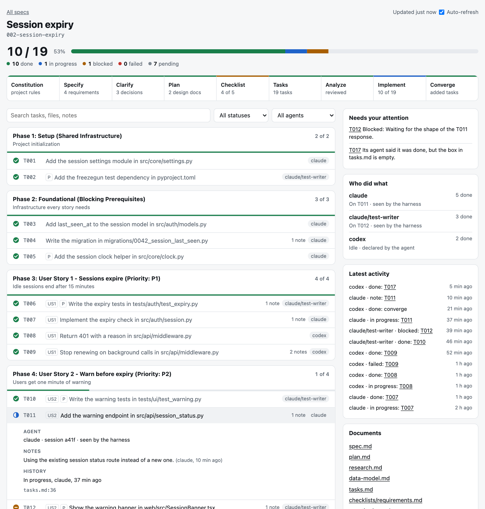
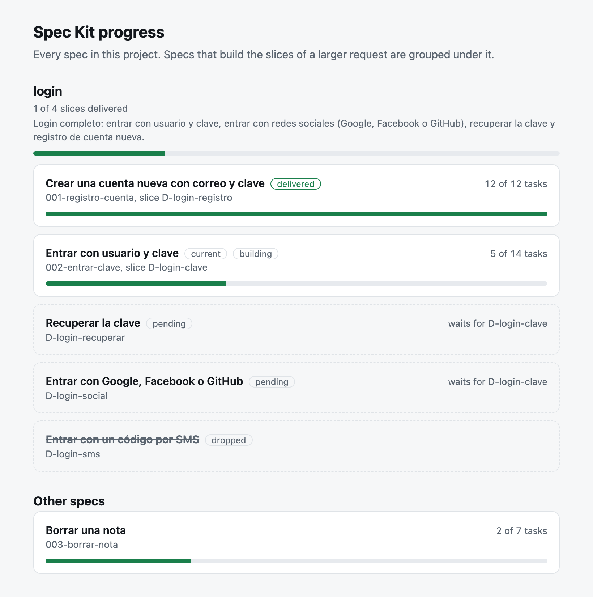

# See how far a spec has come

Every project this fork creates gets a page per spec: the whole plan, every task, the totals, what each agent did and is doing, and the notes on each task. It is a local HTML file. It needs no server and no network, and nothing leaves your machine.



There is nothing to install or turn on. It works in all 43 integrations and with all three script variants (`--script sh`, `ps` and `py`).

## Open it

The first time a command draws a spec's page, it opens in your browser. It opens once per spec, and never over SSH or in CI. Each command also ends its report with the link.

`/speckit.progress` opens the page every time you run it, and its last line says whether it did. It opens the current spec's page, the one you name, or the list of specs when none is current.

| You want to | Run |
| --- | --- |
| Open the page of the current spec | `specify progress open` |
| See the summary in a terminal | `specify progress status` |
| See the summary inside your coding agent, and open the page | `/speckit.progress` |
| Keep the page current from another terminal | `specify progress watch` |
| Find out why something is not working | `specify progress doctor` |
| Stop pages from opening by themselves | `specify progress browser off` |

The page reloads itself while it is open. `.specify/progress/index.html` lists every spec in the project.

### The slices of a larger request

When the project has slice maps, the list groups the specs by map. A slice map is the cut of a larger request into slices of one spec each, written by the `capabilities` extension under `specs/_slices/`. See [One spec, one slice](capabilities.md#one-spec-one-slice).



Each group shows the request, how many of its slices are delivered, and the slices in the order of the map:

| A slice shows as | When |
| --- | --- |
| The card of its spec, marked `specified`, `building` or `delivered` | A spec names the slice |
| A dashed box marked `next` | No spec builds it yet, and it waits for nothing |
| A dashed box marked `pending`, with what it waits for | No spec builds it yet, and a slice it depends on is not delivered |
| A dashed box with its name struck through | The map says it was dropped |

A slice is `delivered` when every task of its spec is closed and, if the spec changes rules, its delta is folded into the catalog. Specs that belong to no map come after the groups, under "Other specs". A project without slice maps gets the plain list.

## What the page shows

- **Totals:** how many tasks are done, in progress, blocked, failed, skipped and pending.
- **The steps:** Constitution, Specify, Clarify, Plan, Checklist, Tasks, Analyze, Implement and Converge, each with a fact such as "3 decisions" or "10 of 19". Click a step, or point at it, to see what the fact is made of.
- **The Checklist step:** it counts the boxes of every file in `checklists/`, and shows each file on its own.
  - `requirements.md` is the spec-quality checklist that `/speckit.specify` and `/speckit.clarify` keep and check themselves. An unchecked box there is a gap in the spec, so the step needs attention.
  - Every other checklist comes from `/speckit.checklist`, which never checks a box: `[x]` means a reviewer approved that item. Unchecked boxes there leave the step **awaiting review**, and once the command has reported that it finished, the fact reads like "generated · 16 of 55 reviewed".
  - With every box checked, the step is done.
- **The tasks by phase and story:** open one to see its notes, its files, its history and who worked on it.
- **Who did what:** how many tasks each agent closed, and which one it is on now.
- **What needs your attention:** blocks, failures, and contradictions such as an agent saying it finished a task whose box is still empty. Every step that needs attention or awaits review says why here, for example "measurement.md: 39 items await reviewer review."
- **The documents:** `spec.md`, `plan.md` and the others.

## What you can rely on

Spec Kit does not run your agents, it gives them instructions. So the page keeps apart what comes from files and what a model chose to report.

| What the page says | 10 integrations with native events | 32 with commands only | `none` |
| --- | --- | --- | --- |
| Totals, and which tasks are done, from `tasks.md` | Always | Always | With `specify progress` |
| The page is current with no model involved | After each tool call | When a command starts, or always with `watch` | With `watch` |
| In progress, blocked, notes | The model reports them | The model reports them | Not available |
| Which harness did it | Seen by a hook | From the project setup | Not available |
| Which session or subagent did it | Seen by a hook, where the harness says so | Reported by the model | Not available |

The integrations with native events are `claude`, `codex`, `copilot`, `cursor-agent`, `devin`, `gemini`, `opencode`, `qwen`, `tabnine` and `vibe`.

If a model skips a report, the totals stay right, and the page only lacks the "in progress" or the note. A task checked with no report shows as done, with no record of who did it.

### Who did it

Each report on the page says where its author came from:

- **Seen by the harness:** a hook saw the call being made. See [what each harness sends](https://github.com/lema017/speckit-vs/blob/main/design/progress.md#what-each-harness-sends) for which ones report a session or a subagent, and how that was checked.
- **From the project setup:** the integration the project was installed with. No hook confirmed it.
- **Declared by the agent:** a name the model gave with `--agent`. No harness confirmed it.

## What agents do

`/speckit.implement` tells the agent to report each task through the progress script, which checks the box and writes the log in one call, under a lock, so several agents can work at once. Your agent runs these by itself, and you can too:

```bash
.specify/scripts/bash/progress.sh start T011
```

```bash
.specify/scripts/bash/progress.sh done T011 --note "Rate limit lives in middleware" --files src/limit.py --then T012
```

```bash
.specify/scripts/bash/progress.sh block T012 --reason "Needs the staging key"
```

```bash
.specify/scripts/bash/progress.sh fail T009 --reason "The migration breaks the old table"
```

```bash
.specify/scripts/bash/progress.sh skip T010 --reason "Covered by T009"
```

```bash
.specify/scripts/bash/progress.sh note T011 "Left the old endpoint for now"
```

With other script variants, use `.specify/scripts/powershell/progress.ps1` or `.specify/scripts/python/progress.py`. When the agent delegates a task to a subagent, it adds `--agent <name>` to these calls. A failed report never stops the work: the agent reads the message, marks the box by hand if it has to, and carries on.

## Where it keeps things

| File | What it is | In Git |
| --- | --- | --- |
| `specs/<id>/progress.jsonl` | The log of steps and reports, one JSON object per line | Yes, with `merge=union`, so two branches can both add to it |
| `specs/<id>/.gitattributes` | That merge rule | Yes |
| `.specify/progress/*.html` | The pages | No, they are drawn again whenever needed |

> [!WARNING]
> Notes go into `progress.jsonl`, which is versioned. The instructions tell agents never to put a secret in a note, but nothing filters them. If you push the log, read what it says first.

## Turn parts of it off

The page itself has no off switch. You can turn off what acts on its own:

- **Pages opening by themselves:** `specify progress browser off`, or set `SPECKIT_PROGRESS_NO_BROWSER=1`. Pages are still drawn. This also keeps `/speckit.progress` from opening the page: it says so and gives the link.
- **Native events:** install with `--integration-options="--events false"`, and the hooks are not added. The page falls back to updating when a command calls it, or with `watch`. See [integration events](../integrations/cli.md).

A hook is code that runs on your machine by itself, so you may want to look at it first. It is `.specify/scripts/progress/hook.py`, and it only reads project files, writes the page and the log, and prints one line at the start of a session.

### Codex asks you to approve hooks

Codex skips a new or changed hook until you approve it in `/hooks`. Until then, the page updates only when a command calls it. A later version of this fork that changes the hook needs your approval again. `specify progress doctor` reminds you of this.

## Add it to an existing project

```bash
specify integration upgrade claude
```

Use your own integration key. The tasks already checked appear as done, with no record of who did them, because that history does not exist.

## Limits

- **"In progress" depends on the model.** On small tasks, models tend to report several at once, so it may barely show.
- **A report inside a shell loop cannot be seen.** A hook reads the command, so with `for t in T1 T2; do ... done $t; done` the report is still made, and it stays labelled from the project setup.
- **Only Claude Code and Cursor were tested live.** One real session of each, with Claude Code 2.1.303 and Cursor CLI 2026.11.05, matched their documentation. The other eight harnesses' hook messages come from their published references. If one sends something else, its reports keep a weaker label and the page stays correct.
- **It has a small cost.** With Sonnet 5.5 on an 8-task project, in 3 pairs with and without the instructions, reporting cost $0.0164 more per run. The project is tiny, so the 19.6% it represents there may overstate a real one. That is an inference, as it was not measured on a larger project.
- **A hook runs after every tool call.** When nothing changed, it adds about 54 ms at the 95th percentile on macOS with Python 3.13, and 71 ms with the Python 3.9 macOS includes. Most of that is Python starting. When it has to redraw, about 103 and 140 ms.
- **It does not include extension commands or workflow runs.** Only the core commands have a step on the page.
- **The list reads the slice maps on its own.** It uses the same rule as `slices status`, and a test compares the two. It differs in one case: a spec whose fold is recorded only in the catalog's history, and not in the lock of the spec, does not show as `delivered` here.
- **A change to a slice map alone does not redraw the list.** It shows the next time any command or task report redraws a page.
