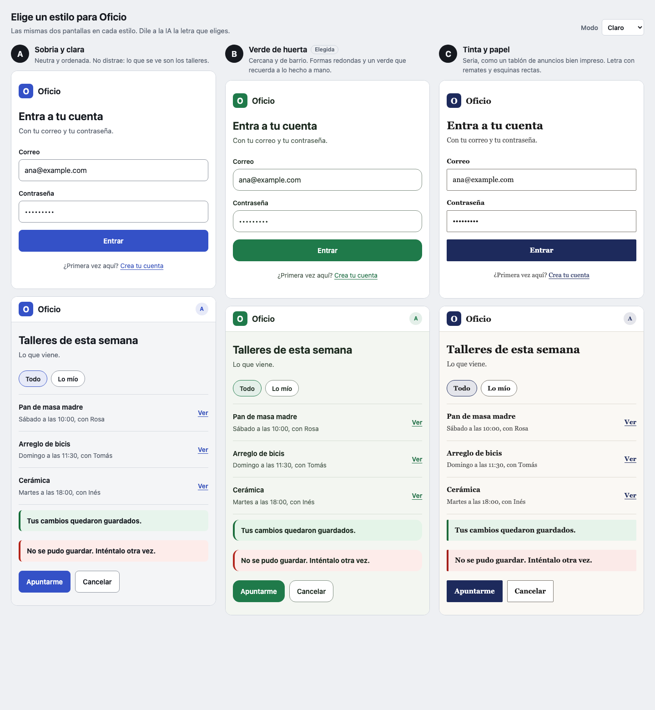
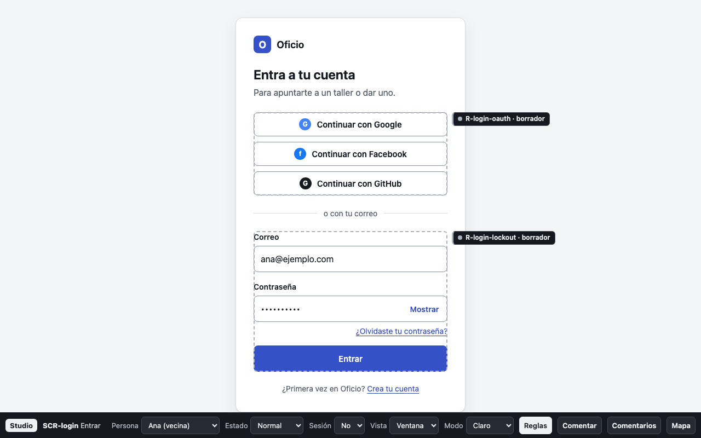
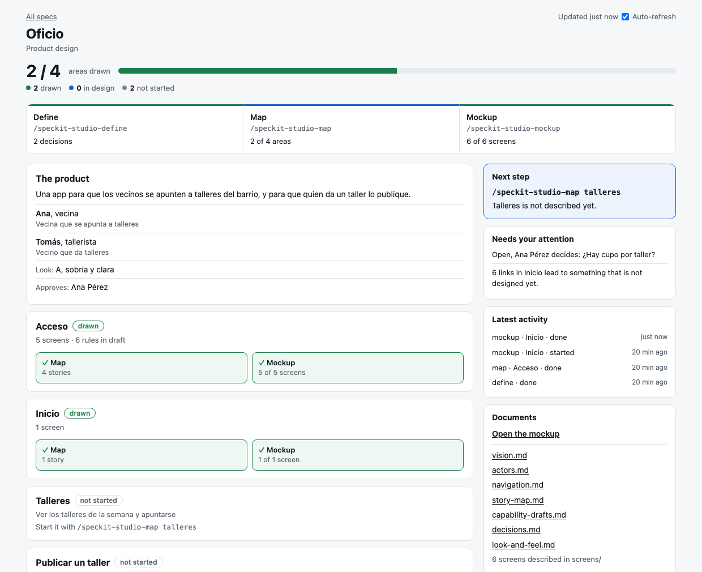

# Design the product first

Before the first spec, a product owner can turn an idea into something they can see: a mockup to click through in the browser, and the business rules of the product in draft. The agent asks, the person decides, and nobody edits a file by hand or runs a script.

This is the `studio` extension. `specify init` installs it in every new project of this fork.

| Step | Command | What you do | What is there afterwards |
| --- | --- | --- | --- |
| 1 | `/speckit-studio-define <your idea>` | Tell the idea and answer questions. Choose one of three looks | The idea in words, the people who use the product, its areas and its look |
| 2 | `/speckit-studio-map <area>` | Answer questions about one area | Each screen described, with every button, and the business rules in draft |
| 3 | `/speckit-studio-mockup` | Nothing: the agent builds it | The mockup open in your browser, and a picture of each screen |

Agents that name commands with dots use `/speckit.studio.define`, `/speckit.studio.map` and `/speckit.studio.mockup`. See [Command invocation](../integrations/cli.md#command-invocation).

## Start the conversation

Run the first command with your idea. One line is enough:

```text
/speckit-studio-define An app for neighbours to sign up for workshops, and for whoever gives one to publish it.
```

The agent says what it understood and asks its first round:

```text
This is what I understood: a neighbourhood app with two kinds of person, one who
signs up for a workshop and one who gives it. To go on I need 4 decisions.

1. Who can publish a workshop?
   a) Any neighbour with an account   (recommended: it is what you wrote)
   b) Only people an administrator approved
   It matters because b) adds an administration area.

2. Is the workshop paid inside the app?   ⚠️ Business decision
   a) No: it is free or paid in person   (recommended for the first version)
   b) Yes, by card
   It matters because b) adds payments, refunds and legal terms.
```

You answer in a few words: `1 a, 2 a, 3 recommended, 4 I don't know`.

- A round has at most 10 questions. Each one is a single decision, with options, a recommended one, and why it matters.
- "I don't know" is an answer. The question stays open with who decides it, and stops nothing.
- A business decision is yours. The agent marks it and never takes it for you.
- The agent asks nothing technical. Databases, languages and servers are decided later, in `/speckit-plan`.
- You can stop and go on another day. Run the same command again: it goes on where it stopped.

This first conversation covers who the product is for, the problem it solves, what each person can do, its areas, what stays out, and where it is used most. Two or three rounds are usual.

### Choose the look

At the end of `define`, the agent proposes three looks and opens them side by side in your browser, on the same two sample screens. You say the letter you choose, or a letter with a change.



## Design one area

You do not design the whole product at once. Choose an area and work on it:

```text
/speckit-studio-map access
```

The agent proposes the stories and the screens of the area, and asks about what it is unsure of: every field, every button and where it leads, how each screen looks when it is empty or fails, what each person sees, and the rules of the business.

When you say something the product must always do, it becomes a rule in draft, shown to you at once:

```text
You:    If someone gets the password wrong many times, lock them out for a while.

Agent:  How many attempts, and for how long?
        a) 5 attempts in a row, 15 minutes   (recommended: it is the usual)
        b) 3 attempts, 30 minutes

You:    a

Agent:  This rule is now in draft:
        "After 5 failed attempts in a row, the account is locked for 15 minutes."
        Example: Ana fails 5 times at 10:00 and can try again at 10:15.
        The screens "Sign in" and "Account locked" apply it.
```

The rules stay in draft. Nothing is approved in this step.

## See the mockup

```text
/speckit-studio-mockup
```

The agent draws each screen that is described, checks the result, opens it in your browser, and shows you a picture of each screen. To open it again by yourself:

```bash
specify studio open
```



In the mockup you can:

- click the buttons and the links, which lead where the design says;
- change the person who is looking, and the state of the screen: empty, loading, wrong;
- see it in the size of a phone or of a window, in light or in dark;
- turn on **Rules** to see which business rule each element applies, with its text;
- open **Map** to see every screen, and walk through a flow step by step;
- use **Comment** to leave a note on any element.

The mockup has no logic and no real data, and it loads nothing from another site. A link to something that is not designed yet says so when you click it.

To change something, say it in the chat in your own words and run the command again: `/speckit-studio-mockup the button should say Sign me up`. The comments you leave in the mockup stay in your browser: copy them from **Comments** and paste them in the chat.

You can run `mockup` as soon as one screen is described. You do not have to finish the conversation to see something.

## See how far the design is

```text
/speckit-progress design
```



The page shows the steps in order with what each one has, each area with its own steps, the command that comes next and why, what waits for you, the latest activity, and the documents of the design. It comes from the files of the design, not from what the agent says it did. Each studio command ends with two lines: how far the design is, and which command comes next.

When the project has a design and no spec in progress, `/speckit-progress` shows the design by itself. In the terminal:

```bash
specify studio status
specify progress open --design
```

## Where the design lives

Everything decided is a Markdown file under `specs/_product/`, which you commit with the project.

| File | What it holds |
| --- | --- |
| `product.md` | The name, who approves, the language, where it is used most |
| `vision.md` | The idea, the problem, what is in and out, the glossary |
| `actors.md` | The people who use the product |
| `navigation.md` | The areas and the flows |
| `story-map.md` | What each person does, and why |
| `screens/SCR-<name>.md` | One screen: its elements and its states |
| `capability-drafts.md` | The business rules, in draft |
| `decisions.md` | Every question, with its answer |
| `directions.md`, `look-and-feel.md` | The three looks, and the one chosen |
| `mockup/` | One page per screen |

`mockup/_studio/`, `mockup/index.html` and `mockup/_shots/` are generated, and `specs/_product/.gitignore` keeps them out of Git.

To check that the files and the pages agree:

```bash
specify studio check
```

It fails when a story has no screen, a button leads to a screen that does not exist, a page uses a state its screen does not have, a rule is cited by nobody, or a page cannot be reached. It notes, without failing, colors that cannot be read and links to something that is not designed yet.

## Add it to an existing project

`specify upgrade` updates the extensions a project already has, and does not add new ones. Add this one once:

```bash
specify extension add studio
```

A project that already has code can use it too. The agent reads what the product already does, and the rules in `specs/_capabilities/` are facts it cites and never rewrites.

## Limits

- **This version stops at the mockup.** Applying comments from the mockup, approving the rules, and cutting an area into specs come in the next versions. Until then the rules stay in draft, and `/speckit-specify` does not read the design by itself: name the screens and the rules in your request.
- **The pictures need a browser.** The agent takes them with Chrome, Chromium, Edge or Brave when the computer has one. Without one, it gives you the link. `SPECKIT_STUDIO_BROWSER` names another browser.
- **The bar of the mockup is in English or Spanish.** A product in another language gets the bar in English. The screens are in the language of the product.
- **Fonts are the ones the computer has.** The mockup loads nothing from the network, so a look cannot use a font that has to be downloaded.
- **PowerShell projects do not get it by default.** Its commands call `python3`. Add it with `--extension studio` to try it.
- **Agents.** The commands are instructions an agent follows. The check and the progress page do not depend on the agent: they read the files.
