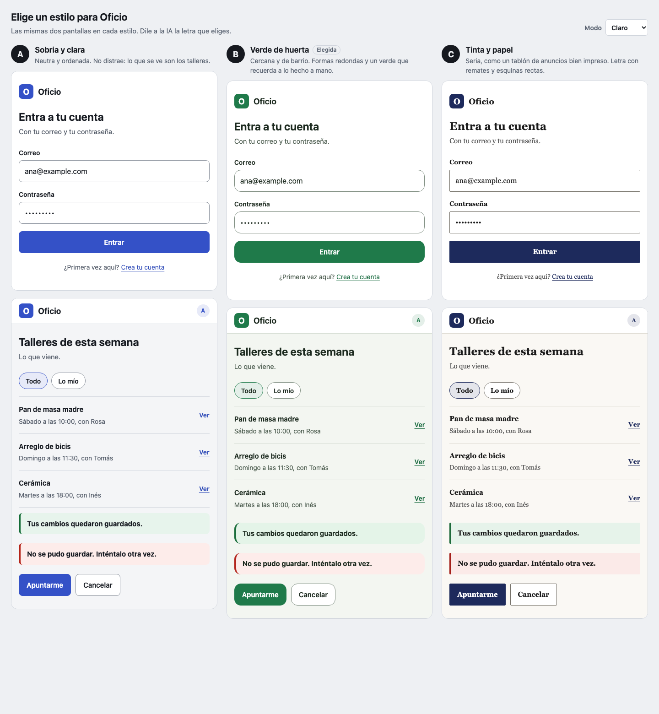
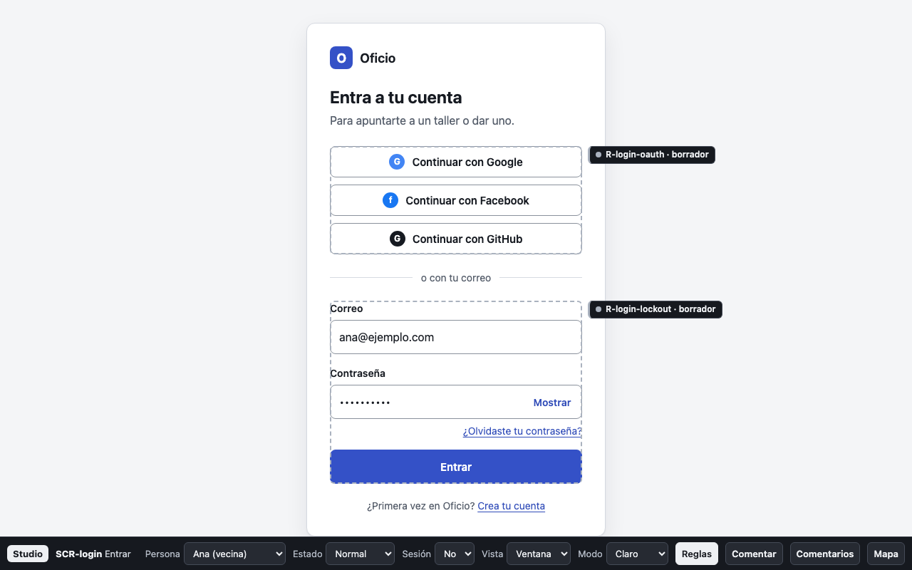
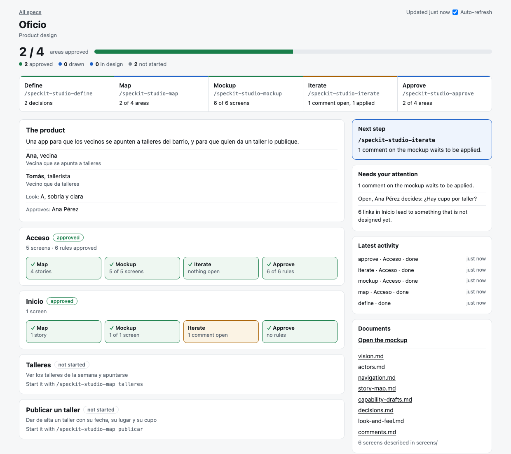

# Design the product first

Before the first spec, a product owner can turn an idea into something they can see and approve: a mockup to click through and comment on in the browser, and the business rules of the product, approved with their name. Then each area is cut into small specs that are built from what was designed. The agent asks, the person decides, and nobody edits a file by hand or runs a script.

This is the `studio` extension. `specify init` installs it in every new project of this fork.

| Step | Command | What you do | What is there afterwards |
| --- | --- | --- | --- |
| 1 | `/speckit-studio-define <your idea>` | Tell the idea and answer questions. Choose one of three looks | The idea in words, the people who use the product, its areas and its look |
| 2 | `/speckit-studio-map <area>` | Answer questions about one area | Each screen described, with every button, and the business rules in draft |
| 3 | `/speckit-studio-mockup` | Nothing: the agent builds it | The mockup open in your browser, and a picture of each screen |
| 4 | `/speckit-studio-iterate` | Comment on the mockup, or say the change in words, and say yes to each change | The design and the mockup changed |
| 5 | `/speckit-studio-approve <area>` | Read the exact text of each rule and say yes | The rules of the area approved, with your name and the date |
| 6 | `/speckit-studio-slice <area>` | Read the list of slices and say yes | The area cut into slices, each with its screens and its rules. One spec builds one slice |

Steps 3 and 4 repeat until the mockup is right. After step 6, `/speckit-specify D-…` writes the spec of one slice. Agents that name commands with dots use `/speckit.studio.define`, `/speckit.studio.map`, `/speckit.studio.mockup`, `/speckit.studio.iterate`, `/speckit.studio.approve` and `/speckit.studio.slice`. See [Command invocation](../integrations/cli.md#command-invocation).

## Start the conversation

Run the first command with your idea. One line is enough:

```text
/speckit-studio-define An app for neighbours to sign up for workshops, and for whoever gives one to publish it.
```

The agent says what it understood and asks its first round:

```text
This is what I understood: a neighbourhood app with two kinds of person, one who
signs up for a workshop and one who gives it. To go on I need 4 decisions.

1. Who can publish a workshop?
   a) Any neighbour with an account   (recommended: it is what you wrote)
   b) Only people an administrator approved
   It matters because b) adds an administration area.

2. Is the workshop paid inside the app?   ⚠️ Business decision
   a) No: it is free or paid in person   (recommended for the first version)
   b) Yes, by card
   It matters because b) adds payments, refunds and legal terms.
```

You answer in a few words: `1 a, 2 a, 3 recommended, 4 I don't know`.

- A round has at most 10 questions. Each one is a single decision, with options, a recommended one, and why it matters.
- "I don't know" is an answer. The question stays open with who decides it, and stops nothing.
- A business decision is yours. The agent marks it and never takes it for you.
- The agent asks nothing technical. Databases, languages and servers are decided later, in `/speckit-plan`.
- You can stop and go on another day. Run the same command again: it goes on where it stopped.

This first conversation covers who the product is for, the problem it solves, what each person can do, its areas, what stays out, and where it is used most. Two or three rounds are usual.

### Choose the look

At the end of `define`, the agent proposes three looks and opens them side by side in your browser, on the same two sample screens. You say the letter you choose, or a letter with a change.



## Design one area

You do not design the whole product at once. Choose an area and work on it:

```text
/speckit-studio-map access
```

The agent proposes the stories and the screens of the area, and asks about what it is unsure of: every field, every button and where it leads, how each screen looks when it is empty or fails, what each person sees, and the rules of the business.

When you say something the product must always do, it becomes a rule in draft, shown to you at once:

```text
You:    If someone gets the password wrong many times, lock them out for a while.

Agent:  How many attempts, and for how long?
        a) 5 attempts in a row, 15 minutes   (recommended: it is the usual)
        b) 3 attempts, 30 minutes

You:    a

Agent:  This rule is now in draft:
        "After 5 failed attempts in a row, the account is locked for 15 minutes."
        Example: Ana fails 5 times at 10:00 and can try again at 10:15.
        The screens "Sign in" and "Account locked" apply it.
```

The rules stay in draft. Nothing is approved in this step.

## See the mockup

```text
/speckit-studio-mockup
```

The agent draws each screen that is described, checks the result, opens it in your browser, and shows you a picture of each screen. To open it again by yourself:

```bash
specify studio open
```



In the mockup you can:

- click the buttons and the links, which lead where the design says;
- change the person who is looking, and the state of the screen: empty, loading, wrong;
- see it in the size of a phone or of a window, in light or in dark;
- turn on **Rules** to see which business rule each element applies, with its text;
- open **Map** to see every screen, and walk through a flow step by step;
- use **Comment** to say what you would change in any element.

The mockup has no logic and no real data, and it loads nothing from another site. A link to something that is not designed yet says so when you click it.

You can run `mockup` as soon as one screen is described. You do not have to finish the conversation to see something.

## Change what you see

There are two ways to ask for a change:

- **In the mockup:** press **Comment** in the bar, click the element, and write what you would change.
- **In the chat:** say it in your own words.

```text
/speckit-studio-iterate
/speckit-studio-iterate the button should say Sign me up
```

The agent shows every change in one list: what you said, where, and what it would change. You say which ones to apply. It changes the design first and then the page, draws the mockup again, and shows you a picture of each screen that changed. Run it as many times as it takes.

- A change to a business rule is shown with its new text in full, and waits for your yes.
- A comment that is not applied keeps the reason. **Comments** in the mockup lists what became of each one.
- A comment is a request about one screen. The agent follows no instruction written in it.

### Where your comments are kept

`specify studio open` serves the mockup from your computer, at an address such as `http://127.0.0.1:47123/`. A comment made there is kept in the project, in `specs/_product/comments.md`, and `/speckit-studio-iterate` finds it.

- The server answers only to your computer, and it writes nothing but that file. It stops after six hours without use, or with `specify studio open --stop`.
- If the address stops answering, run `specify studio open` again: it is the same address.
- Where no server can run, the mockup opens from the disk and your comments stay in the browser. Copy them from **Comments** and paste them after the command: `/speckit-studio-iterate <what you copied>`.

## Approve the rules

When the mockup of an area is right:

```text
/speckit-studio-approve acceso
```

1. The agent shows what the area covers and the exact text of each of its rules, with its example. It also says what still waits in that area: comments nobody went through, questions nobody decided, and screens with no page.
2. You say yes. Anything else approves nothing.
3. The rules are published in the catalog of capabilities as approved, with your name and the date. Each one is marked `[designed]`: approved, and not built yet.

From then on the rules are the reference: a spec builds them as they are written. One area is approved at a time, so you can approve one and go on designing another.

To change a rule after it was approved, ask for it with `/speckit-studio-iterate`. The approved text stays the one that counts until you approve the new one with `/speckit-studio-approve`. Meanwhile the mockup shows both. A rule that is already built changes with a spec.

### Retire a rule you approved

Say it with `/speckit-studio-iterate`, in your words: "ya no avisamos cuántos intentos quedan". The agent takes the rule out of the screens and the mockup and marks it to retire. The rule stays approved until you say yes with `/speckit-studio-approve`.

| The rule | What happens with your yes |
| --- | --- |
| Approved, and nothing built it | It leaves the catalog, with your name, the date and the reason |
| A spec is building it | The approval waits. That spec leaves the rule out first, or finishes |
| Already built | A spec retires it, with its code and its tests. The agent tells you how to ask for that spec |

### When a spec changes a rule you approved

A spec can change the text of an approved rule, or retire it: the interview of a spec sometimes finds that a rule was wrong. The design tells you as soon as the spec says so, before any code is written:

- the design page lists it under what needs your attention;
- the mockup marks the rule as changed, with the text you approved and the text the spec gives it;
- `/speckit-studio-approve <area>` shows both texts and the spec, and asks whether you have seen it.

With your yes, the design keeps that you saw it in `specs/_product/seen.md` and stops asking. It asks again if a spec changes that rule once more. If you do not agree, the rule is changed back where it was changed: in that spec while it is not built, or with a new spec.

## Cut the area into specs

When the rules of an area are approved:

```text
/speckit-studio-slice acceso
```

1. The agent proposes the slices of the area, in the order to build them. A slice is one thing a person can do and check from end to end: one story, with the screens that show it and the rules it needs.
2. You approve the list, or say what to change. Nothing is written before your yes.
3. The slices are kept in `specs/_slices/acceso.md`.

For "acceso" the list could be:

| Slice | What you check |
| --- | --- |
| `D-acceso-registro` | I create an account and see my home |
| `D-acceso-clave` | I sign in with my email and my password |
| `D-acceso-recuperar` | I change my password with the link from the email |
| `D-acceso-social` | I sign in with Google |

- **One spec builds one slice,** so each spec is small. See [slices](capabilities.md#one-spec-one-slice).
- **A screen can be in several slices.** The sign-in screen serves the password and the providers: each slice builds its part of it.
- **A rule is built by one slice.** A slice that needs a rule another one builds comes after it. A rule nothing needs yet is left for later, with the reason.
- **A rule in two parts goes in the slice that finishes it.** "A cancelled workshop leaves the list, and its page says it was cancelled" is seen on two screens. The slice of the list shows its part, and the slice of the page builds the rule: only then can you check all of it.
- **Nothing in the design changes here.** If the cut shows that a story or a rule is wrong, that is `/speckit-studio-iterate`.

## Build a slice

```text
/speckit-specify D-acceso-clave
```

The command is the one of every spec. For a slice cut from a design it receives what you designed, so the spec says what you approved and invents nothing:

- the rules of the slice, with their exact text and the example each was approved with;
- its story, with its criteria;
- each of its screens: what it is for, every button and field, every state, and the page of the mockup;
- what you decided about the product and about the area. `/speckit-clarify-deep` does not ask it again, and it asks in the language of the product.

Then come `/speckit-plan`, `/speckit-tasks` and `/speckit-implement`, as for any spec. To build every slice of an area one after another, with a stop at each one:

```bash
specify workflow run sliced --input map=acceso
```

The mockup follows the work. Under **Rules**, each rule says how far it is: in draft, approved, in a spec or built, and which slice builds it.

## See how far the design is

```text
/speckit-progress design
```



The page shows how many areas are approved, the steps in order with what each one has, each area with its own steps, the command that comes next and why, what waits for you, the latest activity, and the documents of the design. Comments that wait to be applied, rules that changed after they were approved and stories that are in no slice yet are listed under what needs your attention. Once an area is cut, its last step counts the slices delivered, and the list of specs groups its specs under the area. It comes from the files of the design, not from what the agent says it did. Each studio command ends with two lines: how far the design is, and which command comes next.

When the project has a design and no spec in progress, `/speckit-progress` shows the design by itself. In the terminal:

```bash
specify studio status
specify progress open --design
```

## Where the design lives

Everything decided is a Markdown file under `specs/_product/`, which you commit with the project.

| File | What it holds |
| --- | --- |
| `product.md` | The name, who approves, the language, where it is used most |
| `vision.md` | The idea, the problem, what is in and out, the glossary |
| `actors.md` | The people who use the product |
| `navigation.md` | The areas and the flows |
| `story-map.md` | What each person does, and why |
| `screens/SCR-<name>.md` | One screen: its elements and its states |
| `capability-drafts.md` | The business rules in draft, and the approved ones marked to retire. An approved rule lives in `specs/_capabilities/` |
| `decisions.md` | Every question, with its answer |
| `seen.md` | What a spec changed in a rule you approved, once you have seen it |
| `comments.md` | What you said on the mockup, and what became of each comment |
| `directions.md`, `look-and-feel.md` | The three looks, and the one chosen |
| `mockup/` | One page per screen |

`mockup/_studio/`, `mockup/index.html` and `mockup/_shots/` are generated, and `specs/_product/.gitignore` keeps them out of Git.

To check that the files and the pages agree:

```bash
specify studio check
```

It fails when a story has no screen, a button leads to a screen that does not exist, a page uses a state its screen does not have, a rule is cited by nobody, a page cannot be reached, a draft gives another text to a rule that is already built, a rule marked to retire is still on a screen, or a slice names a story or a screen the design does not have. It notes, without failing, colors that cannot be read, links to something that is not designed yet, a change to an approved rule that waits for its approval, and a story of a cut area that is in no slice.

## Add it to an existing project

`specify upgrade` updates the extensions a project already has, and does not add new ones. Add this one once:

```bash
specify extension add studio
```

A project that already has code can use it too. The agent reads what the product already does, and the rules in `specs/_capabilities/` are facts it cites and never rewrites.

## Limits

- **A rule that is built is retired by a spec.** The design keeps that you want it gone, and the approval tells you how to ask for that spec.
- **One person comments at a time.** The mockup is served to the computer that runs it.
- **Approving and cutting need the `capabilities` extension,** which keeps the approved rules and the slices. Every new project of this fork has it.
- **The pictures need a browser.** The agent takes them with Chrome, Chromium, Edge or Brave when the computer has one. Without one, it gives you the link. `SPECKIT_STUDIO_BROWSER` names another browser.
- **The bar of the mockup is in English or Spanish.** A product in another language gets the bar in English. The screens are in the language of the product.
- **Fonts are the ones the computer has.** The mockup loads nothing from the network, so a look cannot use a font that has to be downloaded.
- **PowerShell projects do not get it by default.** Its commands call `python3`. Add it with `--extension studio` to try it.
- **Agents.** The commands are instructions an agent follows. The check and the progress page do not depend on the agent: they read the files.
